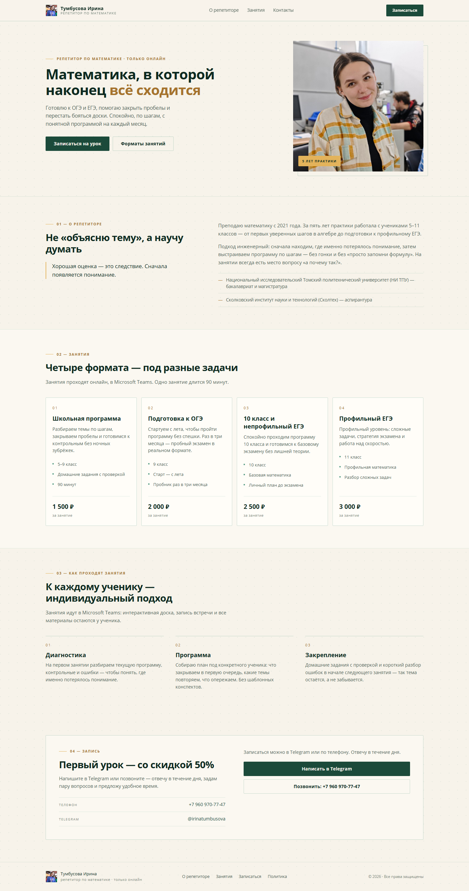

# Тумбусова Ирина — репетитор по математике

Одностраничный сайт-визитка: тёплая светлая гамма, изумрудные линии, золотые акценты.
Свёрстан на чистом HTML, CSS и JavaScript — без сборщиков и зависимостей.

Контакты: +7 960 970-77-47 · [@irinatumbusova](https://t.me/irinatumbusova)



## Структура

```
test-landing/
├── index.html        разметка страницы
├── privacy.html      политика обработки персональных данных (152-ФЗ)
├── styles.css        стили и адаптив
├── fonts/            локальные woff2: Open Sans (400, 700)
├── script.js         маска телефона, валидация, состояния формы
├── photo.jpg         фотография — подхватывается автоматически
├── og-image.png      превью ссылки для мессенджеров и соцсетей (1200×630)
├── .nojekyll         отключает Jekyll на GitHub Pages
├── shot-desktop.png  превью для десктопа
└── shot-mobile.png   превью для мобильного
```

Сайт: https://kozhemyka1.github.io/test-landing/

## Запуск

Откройте `index.html` в браузере — этого достаточно. Либо поднимите локальный сервер:

```bash
python -m http.server 8000
```

## Секции

1. Первый экран — заголовок, кнопки, портрет.
2. О репетиторе — подход, образование, цитата.
3. Занятия — четыре формата с ценами.
4. Как проходят занятия — диагностика, программа, закрепление.
5. Запись — контакты; форма временно отключена (см. комментарий в разметке).

## Фотография

Положите файл рядом с `index.html` с именем `photo.jpg` (поддерживаются также
`.jpeg`, `.png`, `.webp`). Скрипт сам подставит его в портрет; пока файла нет,
показывается заглушка с вензелем.

## Форма

Валидация на клиенте:

- ФИО — минимум два слова, только буквы и дефис;
- телефон — маска `+7 (999) 123-45-67`, `8` в начале заменяется на `+7`;
- согласие на обработку персональных данных — обязательная отметка со ссылкой
  на `privacy.html`.

Отправка пока локальная. Точка интеграции — в `script.js`, в обработчике `submit`:

```js
// fetch('/api/signup', { method: 'POST', body: new FormData(form) })
```

## Шрифты

**Open Sans** (400 и 700) — тот же шрифт, что в проекте Diplom2. Файлы лежат
локально в `fonts/`, без обращений к Google Fonts: страница работает офлайн
и не отправляет IP посетителя третьим лицам.

## Палитра

| Переменная        | Цвет      | Назначение                        |
| ----------------- | --------- | --------------------------------- |
| `--green-900`     | `#0E2A20` | основной текст                    |
| `--green-700`     | `#1B4A3A` | кнопки, монограмма                |
| `--emerald`       | `#1F7A5C` | бордеры, фокус, акценты           |
| `--gold`          | `#E3B35B` | золотые акценты                   |
| `--gold-dark`     | `#A6732D` | подписи, номера секций            |
| `--bg`            | `#F7F3EA` | фон страницы                      |
| `--surface`       | `#FFFDF8` | карточки                          |

## Браузеры

Современные версии Chrome, Firefox, Safari, Edge. Используются `grid`,
`clamp()`, `aspect-ratio`, `backdrop-filter` — без полифилов.
